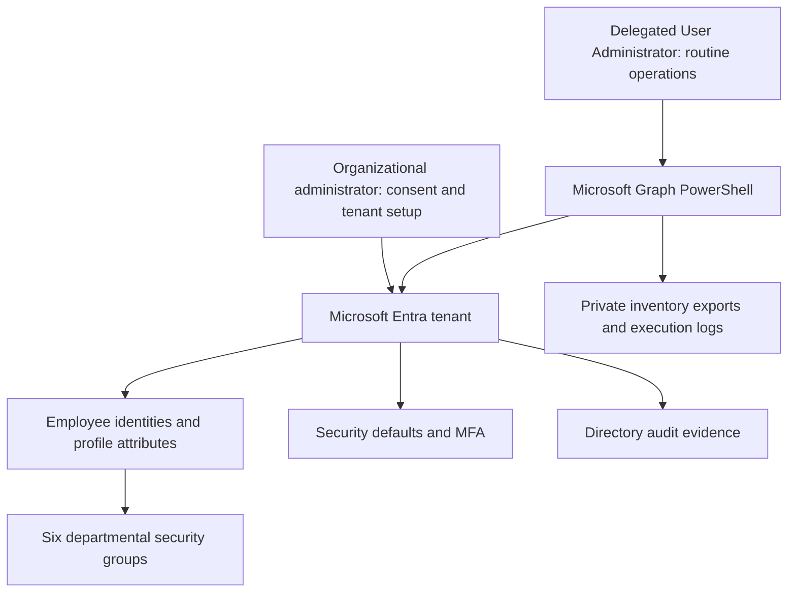

# Architecture and identity model

Northstar Technologies is a fictional organization hosted in one Microsoft Entra tenant. Six assigned cloud security groups represent IT, Security, Finance, HR, Engineering, and Sales. Twelve original employees established the department model; Jordan, Alex, and Casey were added during lifecycle testing. The final inventory observed 18 identities including administrative and original personal identities.

Department groups establish an access-assignment model. No protected application was configured and tested to prove effective access changes. Entra directory roles are separate from department groups: the inventory observed two Global Administrators and one User Administrator, all at tenant scope. Zero Trust principles demonstrated include MFA, separation of administration, least-privilege delegation, and removal of obsolete department membership. This does not establish a complete Zero Trust architecture.
